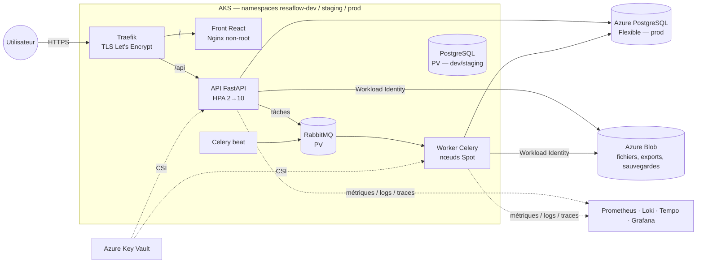

# ResaFlow — du code à la supervision

Application web cloud-native de **réservation de ressources** (salles, matériel) déployée sur **Azure Kubernetes Service**, livrée par **GitHub Actions**, provisionnée par **Terraform**, supervisée par **Prometheus / Grafana / Loki / Tempo**, sécurisée (contrôles **ISO 27001:2022**) et optimisée (**FinOps**).

> Projet de fin de cours — bloc **BC3** « Implémenter et automatiser le déploiement des solutions de données sur le cloud et on-premise » (compétences C6.1 → C8.2).
> Le fonctionnel est volontairement simple ; l'effort porte sur la chaîne d'ingénierie et d'exploitation.



## Correspondance avec la grille d'évaluation

| Axe (points) | Ce qui le démontre | Où |
|---|---|---|
| Conteneurisation & architecture (20) | Dockerfiles multi-stage non-root (API, worker, front), images taguées par SHA et poussées sur ACR, `docker compose` complet | [`backend/Dockerfile`](backend/Dockerfile), [`frontend/Dockerfile`](frontend/Dockerfile), [`docker-compose.yml`](docker-compose.yml) |
| Orchestration Kubernetes (20) | Chart Helm : Deployments, Services, IngressRoute, ConfigMap, Secrets (Key Vault), requests/limits, HPA, PDB, NetworkPolicies, StatefulSets sur PV, CronJob de sauvegarde ; scripts de démo HPA / résilience / rolling update | [`deploy/helm/resaflow`](deploy/helm/resaflow), [`scripts/demo`](scripts/demo) |
| CI/CD & IaC (20) | Pipeline lint → tests → SAST → scans → build → push → dev → staging → **prod canary** avec analyse Prometheus ; Terraform reproductible (bootstrap, azure, platform) | [`.github/workflows`](.github/workflows), [`infra/terraform`](infra/terraform) |
| Observabilité (10) | Métriques RED + métier, logs JSON (Loki), traces OTLP (Tempo), 3 dashboards, 14 alertes, 2 SLO avec alertes de burn rate | [`docs/observabilite.md`](docs/observabilite.md) |
| Sécurité (10) | Chiffrement repos/transit, Entra ID + Azure RBAC, Workload Identity, Key Vault, logs de sécurité, PSS restricted, scans CI — rattachés à l'Annexe A | [`docs/securite-iso27001.md`](docs/securite-iso27001.md) |
| FinOps (10) | Coût chiffré, 4 optimisations appliquées (Spot, arrêt planifié, right-sizing, cycle de vie du stockage), mesure avant/après | [`docs/finops.md`](docs/finops.md) |
| Rapport (10) | Architecture, choix justifiés, arbitrages, difficultés | [`docs/`](docs) + rapport PDF |

## Structure du dépôt

```
backend/            API FastAPI + worker Celery (même image, 2 cibles), migrations Alembic, tests pytest
frontend/           SPA React (Vite), servie par Nginx non privilégié
docker-compose.yml  stack locale : front, API, worker, beat, PostgreSQL, RabbitMQ, Azurite, Mailpit (+ Prometheus/Grafana)
deploy/helm/        chart Helm "resaflow" + values par environnement + dashboards Grafana
infra/terraform/    bootstrap (état distant) · azure (réseau, AKS, ACR, PostgreSQL, Blob, Key Vault, identités, budget) · platform (namespaces, Traefik, cert-manager, monitoring)
.github/workflows/  pipeline applicatif, Terraform, arrêt/démarrage planifié (FinOps)
scripts/ci/         déploiement Helm, tests de fumée, analyse canary
scripts/demo/       PowerShell : provisionnement complet, démos HPA / résilience / rolling update / sauvegarde
scripts/finops/     rapport de coûts réels (API Cost Management)
loadtest/           scénario k6 (seuils = SLO)
docs/               architecture, sécurité ISO 27001, observabilité, FinOps, runbook
```

## Démarrage local (Windows / PowerShell)

Prérequis : Docker Desktop.

```powershell
Copy-Item .env.example .env          # puis remplacer les "change-me"
docker compose up -d --build
docker compose ps                     # migrate doit être "exited (0)", le reste "running"/"healthy"
```

| URL | Service |
|---|---|
| http://localhost:8080 | Application (compte admin = `ADMIN_EMAIL` / `ADMIN_PASSWORD` du `.env`) |
| http://localhost:8000/api/docs | Documentation OpenAPI |
| http://localhost:8025 | Mailpit (e-mails de confirmation et de rappel) |
| http://localhost:15672 | RabbitMQ (file `resaflow`) |

Supervision locale : `docker compose --profile observability up -d` → Grafana sur http://localhost:3000.

Tests :

```powershell
cd backend; python -m venv .venv; .\.venv\Scripts\Activate.ps1
pip install -r requirements-dev.txt; pytest; ruff check .; bandit -c pyproject.toml -r app
cd ..\frontend; npm ci; npm run lint; npm test; npm run build
```

## Kubernetes local (Docker Desktop), sans compte Azure

Prérequis : Docker Desktop avec Kubernetes activé, au moins 8 Go de mémoire et 25 Go de disque libres, `kubectl`, `helm`, `k6`.

```powershell
docker compose down                          # libère les ports 8000/8080
./scripts/demo/setup-local-k8s.ps1           # metrics-server, kube-prometheus-stack, images, chart Helm (valeurs staging)
kubectl get pods,svc,hpa -n resaflow-staging
```

Même chart qu'en production ; Key Vault est remplacé par un Secret (`secrets.local.yaml`, généré, ignoré par git), Blob par Azurite et l'Ingress par un Service LoadBalancer (API sur http://localhost:8000). Grafana : `kubectl port-forward -n monitoring svc/kube-prometheus-stack-grafana 3000:80` (admin / resaflow-local). Les scripts de `scripts/demo/` fonctionnent tels quels sur ce cluster.

> **Abonnement Azure for Students** : AKS y est refusé (tailles de machines `_v7` seules autorisées, quota de 0 vCPU dans les régions permises). Le code Terraform est adapté à cette liste (`Standard_D2as_v7`, pool Spot limité à 1 nœud) ; avec un abonnement doté de quota, `setup-azure.ps1` déploie la plateforme complète sans autre changement. Les démonstrations du rapport ont été réalisées sur le cluster local.

## Déploiement sur Azure (depuis zéro)

```powershell
winget install Microsoft.AzureCLI Hashicorp.Terraform Kubernetes.kubectl Helm.Helm GitHub.cli k6
az aks install-cli ; az login ; gh auth login
./scripts/demo/setup-azure.ps1 -Suffix gs26 -GithubRepo <compte>/resaflow -Email <vous@exemple.fr>
```

Le script enchaîne bootstrap de l'état → stack `azure` → stack `platform` → variables GitHub. Il reste à ajouter des « Required reviewers » sur les environnements GitHub `production` et `infra`, puis à pousser sur `main`. Détails : [`docs/deploiement.md`](docs/deploiement.md).

## Démonstrations (preuves pour le rapport)

| Script | Démontre |
|---|---|
| `scripts/demo/demo-hpa.ps1` | Montée en charge k6 → l'HPA passe de 2 à N pods, puis redescend |
| `scripts/demo/demo-resilience.ps1` | Suppression de pods API, worker tué en pleine tâche, redémarrage de PostgreSQL sans perte |
| `scripts/demo/demo-rolling-update.ps1` | Rolling update + `helm rollback` avec 0 requête perdue |
| `scripts/demo/demo-backup-restore.ps1` | Sauvegarde vers Blob et restauration vérifiée |
| `scripts/finops/cost-report.ps1` | Coût réel quotidien avant/après optimisation |
| `scripts/demo/destroy-azure.ps1` | Destruction complète (puis recréation = reproductibilité) |
