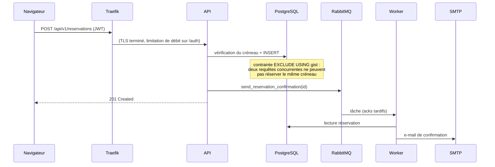
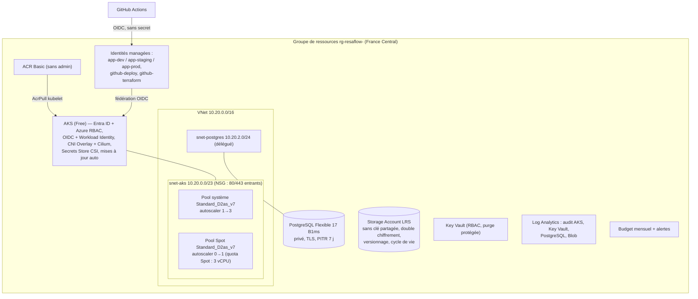
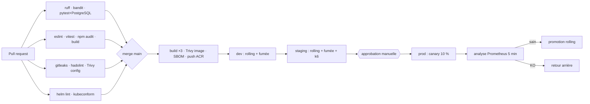

# Architecture

## 1. Vue applicative

ResaFlow permet de réserver des salles et du matériel. Quatre entités : **User**, **Resource**, **Reservation**, **Export**.

| Brique | Technologie | Rôle |
|---|---|---|
| Front-end | React 19 + Vite, servi par Nginx non privilégié | SPA, aucun état serveur |
| Back-end | FastAPI (Python 3.13), SQLAlchemy 2, Alembic | API REST **stateless** : JWT, RBAC user/admin, logique métier |
| Base relationnelle | PostgreSQL 17 | Schéma versionné (Alembic), contrainte d'exclusion anti-chevauchement |
| Stockage objet | Azure Blob Storage (Azurite en local) | Photos des ressources, pièces jointes, exports PDF, sauvegardes |
| File de messages | RabbitMQ 4 | Broker Celery |
| Traitement asynchrone | Worker Celery (+ beat) | E-mail de confirmation, miniature, export PDF, purge planifiée, rappels planifiés |

### Flux « réservation »

### Choix applicatifs justifiés

- **API sans état** : aucune session serveur, JWT signé (HS256, 30 min) → n'importe quel pod peut servir n'importe quelle requête, condition de l'autoscaling horizontal.
- **Double protection anti-chevauchement** : vérification applicative (message clair) + contrainte d'exclusion PostgreSQL (vraie garantie en concurrence, avec plusieurs réplicas).
- **État des tâches en base** (table `exports`) plutôt que dans un backend de résultats Celery : une seule source de vérité, le front interroge l'API.
- **Une image back-end, deux cibles** (`api`, `worker`) : mêmes dépendances et même code, couches partagées, mais deux images distinctes et deux Deployments distincts.
- **Panne du broker tolérée** : si RabbitMQ est indisponible, la réservation est créée, l'erreur est journalisée (dégradation contrôlée).
- **Fichiers validés côté serveur** : taille, type déclaré ET contenu réel (Pillow / signature PDF), clés opaques (UUID) → ni traversée de chemin ni fichier déguisé.

## 2. Vue infrastructure Azure

### Arbitrages d'infrastructure

| Décision | Alternative écartée | Raison |
|---|---|---|
| **Un cluster, trois namespaces** (dev/staging/prod) | Un cluster par environnement | Coût ×3 ; la séparation est assurée par namespaces + PSS + quotas + NetworkPolicies + identités Azure distinctes par environnement + conteneurs Blob et secrets distincts. Limite assumée : un incident de nœud touche tous les environnements. |
| **PostgreSQL managé en prod**, **StatefulSet sur PV** en dev/staging | Tout managé / tout in-cluster | Prod : sauvegardes PITR, correctifs, chiffrement gérés par Azure. Dev/staging : ~0 € de plus et démonstration explicite du stockage persistant Kubernetes exigé par le sujet. |
| **RabbitMQ in-cluster** (1 réplica sur PV) | Azure Service Bus | Celery supporte nativement AMQP ; Service Bus aurait ajouté un transport moins éprouvé. Un cluster RabbitMQ à 3 nœuds (quorum queues) serait la cible d'une vraie prod. |
| **Traefik** | ingress-nginx | ingress-nginx n'est plus maintenu depuis mars 2026 (aucun correctif de sécurité). Traefik offre nativement la répartition pondérée (canary) et la limitation de débit. |
| **AKS Free tier** | Standard (SLA 99,9 %) | Projet pédagogique : le SLA du plan de contrôle ne justifie pas ~70 $/mois. |
| **CNI Overlay + Cilium** | kubenet / Azure CNI classique | Peu d'adresses VNet consommées, NetworkPolicies appliquées par eBPF. |
| **Pas de points de terminaison privés par défaut** | Private endpoints Blob/Key Vault | ~7 $/mois chacun ; le code est prêt (`enable_private_endpoints = true`). Compensé par l'authentification Entra ID obligatoire (clés partagées désactivées) et TLS. |
| **sslip.io** pour le nom d'hôte | Domaine acheté + zone DNS | Pas de coût ni de délai ; `INGRESS_HOST` permet de passer à un vrai domaine. |

## 3. Vue Kubernetes

| Objet | API | Worker | Beat | Front | PostgreSQL | RabbitMQ |
|---|---|---|---|---|---|---|
| Contrôleur | Deployment (+ canary) | Deployment | Deployment (Recreate, 1) | Deployment | StatefulSet + PVC | StatefulSet + PVC |
| Scaling | HPA 2→10 (CPU 70 %) | HPA 1→5 | 1 fixe | 2 fixes | 1 | 1 |
| Disponibilité | PDB minAvailable 1, maxUnavailable 0, preStop | PDB maxUnavailable 1 | — | PDB minAvailable 1 | — | — |
| Sondes | startup, readiness (base), liveness | readiness/liveness (métriques) | — | readiness/liveness | pg_isready | rabbitmq-diagnostics |
| Sécurité | non-root, FS lecture seule, caps supprimées, seccomp | idem | idem | idem (UID 101) | non-root (UID 70) | non-root (UID 999) |

Autres objets : ConfigMap, SecretProviderClass (Key Vault → Secret), ServiceAccount (Workload Identity, sans jeton Kubernetes monté), Job de migration (hook Helm), CronJob de sauvegarde, IngressRoute + Middlewares + Certificate, NetworkPolicies (deny-all + flux explicites), Role/RoleBinding opérateur, ServiceMonitor, PrometheusRule, ConfigMap de dashboards. Au niveau namespace (Terraform) : Pod Security Standards `restricted`, ResourceQuota, LimitRange.

## 4. Chaîne CI/CD

Voir [`deploiement.md`](deploiement.md) pour le détail.
